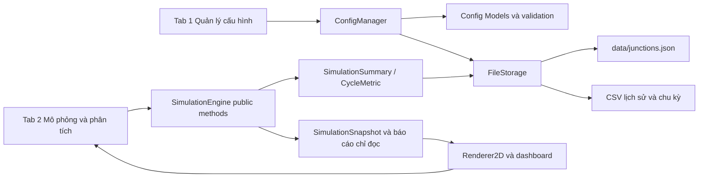
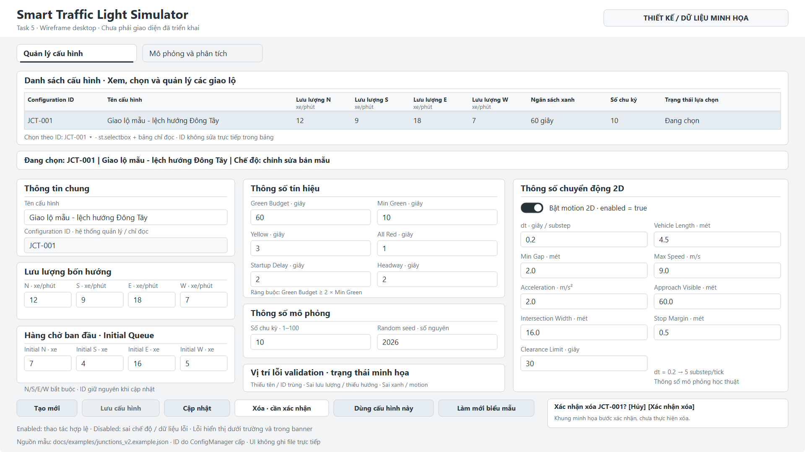
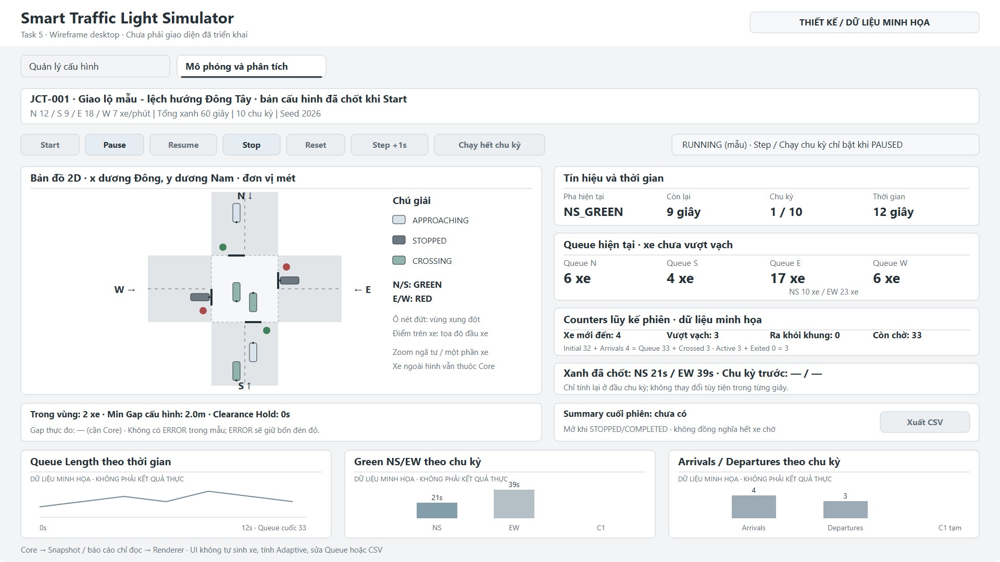

# Hợp đồng UI và Storage Task 5

Cập nhật runtime đến 17/10: FileStorage/ConfigManager và regression tests đã có;
xem [Storage implementation](storage_implementation.md). Các trạng thái chuẩn bị bên dưới là
lịch sử Task 5, không phải kết quả chạy test hiện tại. UI/CSV vẫn là phần riêng.

## 1. Mục tiêu và phạm vi

Mốc kế hoạch **12/10/2026**, thực hiện **13/10/2026**. Chốt wireframe desktop
hai tab, JSON cấu hình V2, validation, lưu trữ và luồng tương tác để UI/Storage
lập trình độc lập. PNG/SVG là **wireframe**, không phải ảnh chụp ứng dụng đã chạy.
CRUD, ConfigManager, FileStorage, engine, chart thật và renderer động chưa triển khai.

Đã đối chiếu tài liệu `Traffic Light Signal Simulation/Thiết kế hệ thống smart
traffic light.docx`, hồ sơ D2.3/V2.3, mục **9.5, 11.1–11.6, 12.1–12.5**.
Các tham số số học đối chiếu thêm mục 3.4. Đã đọc hợp đồng
[Task 3](https://github.com/hmngoc476/SmartTrafficLight/blob/958d3361ea890feeac44b5263ab4a8ac5c862c60/docs/algorithm_contracts.md)
và [Task 4](https://github.com/hmngoc476/SmartTrafficLight/blob/a5c77c2319a0922a2a90c6b9d7302f5b75ecdc29/docs/simulation_contracts.md)
từ Git; chúng ở các branch riêng, không merge vào feat/ui trong Task 5.
Chi tiết API hoặc UX bổ sung được ghi **ĐỀ XUẤT THIẾT KẾ**.

## 2. Sơ đồ hai tab và phân tầng



Đây là **luồng dự kiến**. UI tạo payload từ form và hiển thị lỗi; ConfigManager
kiểm tra cấu hình/nghiệp vụ; FileStorage duy nhất đọc/ghi file. Models mô tả DTO.
Renderer nhận dữ liệu chỉ đọc, không sinh Poisson, tính Adaptive, sửa Queue,
đếm crossing bằng vị trí hoặc trực tiếp mở JSON/CSV.

## 3. Wireframe Tab 1



[SVG chỉnh sửa](wireframes/tab1_config.svg). Khung **1920×1080, 16:9**, màu trung tính.
Bảng toàn chiều ngang có ID, tên, bốn rate, ngân sách xanh, số chu kỳ và lựa chọn.
Banner cho biết ID/tên/mode đang sửa. Ba cột biểu mẫu gồm thông tin chung và
bốn hướng; tín hiệu/mô phỏng/validation; thông số 2D. Các nút và khung xác nhận
xóa đặt cuối form. Nhãn có đơn vị, ID chỉ đọc, nút Lưu mờ vì mẫu ở chế độ EDIT.
Khung lỗi và xác nhận là preview các trạng thái, không phải lỗi/xóa đã thực hiện.

## 4. Wireframe Tab 2



[SVG chỉnh sửa](wireframes/tab2_simulation.svg). Bố cục gồm cấu hình đã chốt,
controls, bản đồ 2D lớn bên trái và HUD bên phải, hàng cảnh báo/summary, ba chart.
Mẫu RUNNING nên Start/Resume/Reset/Step/Chạy chu kỳ disabled, Pause/Stop enabled.
Xuất CSV disabled vì chưa có summary. Số liệu và charts đều ghi **minh họa**.

Hệ trục theo Task 4: +x Đông, +y Nam, N đi xuống, S đi lên, E sang Tây, W sang Đông.
Vạch mẫu N(-2,-8), S(2,8), E(8,-2), W(-8,2); vùng xung đột [-8,8]².
Xe vẽ theo đầu xe từ `stop + s*d`, thân lùi theo chiều dài; không đổi dấu y của
Core. Mẫu zoom vùng giữa và chỉ vẽ một phần xe, không hàm ý xóa xe ngoài hình.
Chiều rộng biểu tượng xe chỉ minh họa, không thay cho chiều rộng vật lý chưa chốt.

Mẫu JCT-001 dùng rate 12/9/18/7, budget 60, 10 chu kỳ, seed 2026 như JSON.
Ví dụ chốt chu kỳ đầu 21/39 theo Task 3; tại 12s NS_GREEN còn 9s, chưa có chu kỳ
trước. Initial=32, arrivals=4, crossed=3, exited=0, active=3; Queue=6/4/17/6,
NS=10, EW=23, còn chờ=33. Bảo toàn 32+4=33+3 và 3=3+0. Hai xe active còn trong
vùng, một xe active đã ra khỏi vùng nhưng chưa EXITED. Đây là dữ liệu dựng thủ
công cho wireframe; không phải JSON Snapshot mẫu riêng của Task 4 hoặc kết quả engine.

## 5. Thành phần UI và trạng thái nút

### Tab 1

| Thành phần / nút | Hành vi dự kiến | Enabled / disabled / lỗi / xác nhận |
| --- | --- | --- |
| Bảng st.dataframe | Chỉ đọc cấu hình, đủ chín cột wireframe | Không sửa ID trong bảng |
| Selectbox ID | Chọn đúng bản ghi và nạp draft form | Không dùng vị trí dòng làm định danh |
| Thông tin chung | Name; ID hệ thống cấp, readonly | Tên thiếu báo dưới trường |
| Rate N/S/E/W | number_input, xe/phút | 0–30; đủ bốn hướng |
| Initial Queue N/S/E/W | number_input, xe | int 0–100 |
| Tín hiệu | budget, min, yellow, all-red, startup, headway | Giây nguyên; validation chéo |
| Mô phỏng | cycles, seed | Số nguyên; cycles 1–100 |
| Motion 2D | Toggle và đủ chín tham số số học | Giữ/validate tham số cả khi toggle tắt |
| Tạo mới | Chuyển mode NEW, draft theo giá trị mặc định mẫu | Không ghi file; ID cấp khi lưu |
| Lưu cấu hình | manager.create(payload) | Chỉ NEW, dữ liệu hợp lệ, không có lỗi load/write chưa xử lý |
| Cập nhật | manager.update(id, payload) | Chỉ EDIT, ID tồn tại; giữ nguyên ID |
| Xóa | Mở xác nhận với ID/tên rõ ràng | Không xóa ngay; Hủy giữ nguyên; lỗi ghi không cập nhật danh sách |
| Dùng cấu hình này | Đặt selected_config_id từ bản đã lưu | Không dùng draft chưa lưu; không đổi bản chốt phiên đang chạy |
| Làm mới biểu mẫu | Bỏ draft và nạp lại bản đã lưu/mặc định | Có xác nhận nếu draft thay đổi; không reset Engine |

**ĐỀ XUẤT THIẾT KẾ:** không cho xóa ID đang dùng trong phiên RUNNING/PAUSED;
thông báo Dừng trước khi xóa. Cập nhật bản cấu hình trên đĩa vẫn có thể được
thực hiện nhưng không thay đổi bản chốt của phiên. Khi xóa ID đang chọn sau khi
phiên đã dừng, làm sạch selected_config_id/draft và yêu cầu chọn lại, không chọn
âm thầm bản ghi khác. Khi file load lỗi, có thể xem/sửa draft nhưng không lưu đè.

### Tab 2

| Control | Điều kiện enabled | Hành vi dự kiến |
| --- | --- | --- |
| Start | Chưa có engine hoặc phiên đã kết thúc; cấu hình đã lưu hợp lệ | Tạo run_id/Engine một lần từ bản sao cấu hình |
| Pause | RUNNING | engine.pause(), không tick |
| Resume | PAUSED | engine.resume() |
| Stop | RUNNING hoặc PAUSED | engine.stop(), chốt summary, ghi lịch sử qua Core/Storage |
| Reset | PAUSED/STOPPED/COMPLETED/ERROR, có bản chốt | Xác nhận bỏ tiến độ; tạo lại theo cùng bản chốt/seed |
| Step +1s | PAUSED | engine.run_ticks(1), một Poisson/tick và năm substep |
| Chạy hết chu kỳ | PAUSED | Gọi public API tới ranh giới chu kỳ thực tế, kể cả hold |
| Xuất CSV | Có Summary/CycleMetric đã chốt | Core/Storage xuất; UI chỉ nhận nội dung tải xuống |

Start khi PAUSED disabled, dùng Resume. Reset khi RUNNING disabled, yêu cầu
Pause/Stop. **ĐỀ XUẤT THIẾT KẾ:** Reset dùng lại bản chốt hiện tại, tạo run_id mới;
muốn chạy cấu hình khác thì kết thúc phiên và Start mới. Không tự đổi seed khi reset.
Khóa controls khi đang thực hiện lệnh để không double-click tạo hai Engine/run_id.
Các trạng thái disabled được đánh giá từ Core; không dùng màu nút làm logic.
COMPLETED chỉ nghĩa là đủ số chu kỳ, có thể vẫn còn xe trong Queue.

## 6. UI → ConfigManager → FileStorage

UI giữ draft, gọi public manager.list/create/update/delete/get/validate.
ConfigManager kiểm tra kiểu, miền, quan hệ budget/min/dt, ID duy nhất và khóa ID
khi update, rồi gọi FileStorage. Chỉ sau khi ghi thành công mới cập nhật cache,
lựa chọn và thông báo thành công. Lỗi ghi giữ nguyên file/cache trước thao tác,
draft còn để người dùng sửa hoặc thử lại. Storage không chứa widget Streamlit.

**ĐỀ XUẤT THIẾT KẾ:** Manager cấp ID kiểu JCT-001 theo bộ cấp của nhóm và kiểm tra
duy nhất trên tập hiện hành trước khi ghi; JSON chỉ yêu cầu chuỗi không rỗng,
không áp regex JCT hoặc tự đoán ID ngoài dữ liệu. Khi đọc không tự đổi/trim ID
khiến hai ID hợp nhất. ID update mặc định bất biến; thao tác đổi ID cần thiết kế riêng.

## 7. Engine → Snapshot → Renderer và dữ liệu dashboard

Task 4 snapshot v1 có vehicles, geometry, signals, metrics, sim_time/cycle/state;
UI đọc các DTO frozen hoặc `to_dict()` tách biệt. Engine không được tái tạo ở rerun.
Renderer không đọc Lane.queue hay MovementEngine.active_crossing, không gọi popleft.

**Khoảng trống hợp đồng đã nhận diện:** Snapshot Task 4 chưa có green hiện tại/
trước, chuỗi chart, số xe giao vùng xung đột, minimum gap thực đo hoặc Summary.
Không tự sửa class/schema Task 4 để thêm các trường này trong Task 5.
**ĐỀ XUẤT THIẾT KẾ:** Core cung cấp `DashboardData` chỉ đọc gồm snapshot, current/
previous SignalPlan report, q_ns/q_ew, QueueSeries, CycleMetricSeries,
conflict_occupancy_count, observed_min_gap_m hoặc None, SimulationSummary hoặc None.
Đây là hợp đồng bổ sung để review, chưa tạo DTO hoặc implementation mới.

| Vùng UI | Nguồn dữ liệu dự kiến |
| --- | --- |
| Cấu hình đã chọn | Bản chốt cấu hình phiên, không đọc lại draft đang sửa |
| Xe/tín hiệu/timer/counters | Task 4 SimulationSnapshot |
| Queue NS/EW, green hiện tại/trước | Báo cáo chỉ đọc từ Core/SignalPlan |
| Queue theo thời gian | QueueSeries chụp cuối tick, x=sim_time, y=tổng xe chưa crossing |
| Green theo chu kỳ | CycleMetric, x=cycle_index, series NS/EW; lịch chốt đầu chu kỳ |
| Arrivals/Departures | CycleMetric, departed nghĩa là vượt vạch; dữ liệu chu kỳ chưa chốt ghi nhãn tạm |
| Conflict count / gap thực đo | Core geometry/movement report, không lấy active_count làm conflict_count |
| Cuối phiên / CSV | SimulationSummary và nội dung xuất từ Storage |

Thiếu báo cáo thì hiện “Chưa có dữ liệu”, không tạo số 0 hoặc chart giả. Min Gap
cấu hình và gap thực đo có nhãn khác nhau; width xe chưa chốt không được suy ra từ
kích thước biểu tượng UI. clearance_hold_s trong Task 4 metrics là **chu kỳ hiện
tại**, còn CSV summary là **tổng phiên**, phải được Core tổng hợp đúng scope.
Tên avg_wait_departed_s giữ legacy nhưng UI ghi “Thời gian từ xuất hiện tới vượt
vạch”; avg_stopped_delay_s mới là thời gian đứng yên, không suy ra từ legacy.

## 8. JSON Schema V2 và tương thích

[JSON mẫu](examples/junctions_v2.example.json), [JSON Schema](schema/junctions_v2.schema.json).
Root chính thức: `schema_version: 2`, **configs**, không dùng configurations song song.
Schema dùng [JSON Schema Draft 2020-12](https://json-schema.org/draft/2020-12/json-schema-validation),
khai báo `$schema` và `additionalProperties:false` ở root/config/map/motion.
Không thêm alias arrival_rates/green_budget/green_min/motion_dt_s. Mọi trường
mẫu đều bắt buộc; không tự thêm stats hoặc vehicles vào JSON cấu hình.

`data/junctions.json` ban đầu đúng skeleton `{"schema_version":2,"configurations":[]}`,
không chứa dữ liệu người dùng. Task 5 chỉ đổi khóa sang configs, vẫn để mảng rỗng;
README và assertion JSON của smoke test được đồng bộ. JSON mẫu nằm riêng trong docs.

Nếu legacy configurations có dữ liệu: giữ raw file, sao lưu, hiển thị preview đổi
khóa, validate toàn bộ và chỉ ghi sau xác nhận; không nhập hai root thành một tập
âm thầm. Nếu có cả configs/configurations thì báo xung đột cần xử lý, không tự gộp.
Với V1: nạp/giữ dữ liệu cũ, tạo candidate V2 với defaults motion_2d theo mẫu, đối
chiếu schema V1 thực tế trước khi map các trường, validate/preview/backup rồi lưu
có kiểm soát. Task 5 không hiện thực migration, không suy đoán các khóa V1 chưa đọc.

## 9. Bảng trường, kiểu và đơn vị

Default dưới đây là giá trị mẫu để dựng form, không làm trường bắt buộc trở thành
tùy chọn khi đọc file. Integer khi gọi Core phải là int Python, không nhận bool.

| Trường JSON | Kiểu | Đơn vị / ý nghĩa | Mẫu / điều kiện |
| --- | --- | --- | --- |
| schema_version | integer | Phiên bản file cấu hình | Đúng 2 |
| configs | array[object] | Danh sách cấu hình | Có thể rỗng; ID không trùng |
| configs[].id | string | Định danh cấu hình | JCT-001; không rỗng/whitespace; update giữ ID |
| configs[].name | string | Tên hiển thị | Chuỗi có nội dung sau strip |
| rates_per_min.N/S/E/W | number, đủ bốn khóa | Xe/phút của từng hướng | 12/9/18/7; 0–30, hữu hạn, không bool |
| initial_queue.N/S/E/W | integer, đủ bốn khóa | Xe ban đầu từng hướng | 7/4/16/5; 0–100 |
| green_budget_s | integer | Tổng giây xanh, không gồm vàng/all-red | 60; >=2*min_green_s |
| min_green_s | integer | Giây xanh tối thiểu mỗi pha | 10; >=1 |
| yellow_s | integer | Giây vàng mỗi pha | 3; >=1 |
| all_red_s | integer | Giây đỏ toàn bộ danh định | 1; >=1 |
| startup_delay_s | integer | Giây trễ đầu pha xanh | 2; >=0 |
| headway_s | integer | Giây giữa hai lần crossing cùng làn | 2; >=1 |
| cycles_to_run | integer | Chu kỳ thử nghiệm | 10; 1–100 |
| seed | integer | Seed tái lập | 2026; không thêm giới hạn dấu hoặc tối đa |
| motion_2d | object | Tham số chuyển động | Đủ mười khóa dưới đây |
| motion_2d.enabled | boolean | Bật/tắt 2D | true; không nhận 0/1 như boolean |
| motion_2d.dt_s | number | Giây mỗi substep | 0.2; 0<dt<=1 và chia tick 1s |
| motion_2d.vehicle_length_m | number | Mét chiều dài xe | 4.5; >0 |
| motion_2d.min_gap_m | number | Mét khoảng trống tối thiểu | 2.0; >=0 |
| motion_2d.max_speed_mps | number | m/s tốc độ tối đa | 9.0; >0 |
| motion_2d.accel_mps2 | number | m/s² gia tốc | 2.0; >0 |
| motion_2d.approach_visible_m | number | Mét đường tiếp cận hiển thị | 60.0; >0 |
| motion_2d.intersection_width_m | number | Mét bề rộng giao lộ | 16.0; >0 |
| motion_2d.stop_margin_m | number | Mét chừa trước vạch | 0.5; >=0 |
| motion_2d.clearance_limit_s | number | Giây hold tối đa trước ERROR | 30; >0, hữu hạn |

V2.3 chỉ quy định clearance_limit>0, không yêu cầu nguyên; hợp đồng dùng number,
không tự thêm ngưỡng tối đa. Tất cả number phải hữu hạn. JSON Schema integer
có thể nhận 1.0 vì phần thập phân bằng 0; để tương thích Core Task 3, Manager
kiểm tra int Python tại các trường integer và không tự ép kiểu float/string/bool.
Đây là quy tắc tầng ứng dụng, không giả vờ JSON Schema tự kiểm tra biểu diễn lexical.
Đã đối chiếu [định nghĩa numeric types](https://json-schema.org/understanding-json-schema/reference/numeric).

## 10. Ràng buộc validation

| Nhóm | JSON Schema kiểm tra | ConfigManager / parser kiểm tra thêm |
| --- | --- | --- |
| Root | Version=2, configs array, required, không alias | Migration có kiểm soát, bảo toàn raw lỗi |
| ID/name | string, minLength, pattern có ký tự không whitespace | IDs duy nhất theo giá trị; ID update không đổi |
| Directions | Đúng và đủ N/S/E/W, không key thừa | Không đổi hướng hoặc silently fill dữ liệu thiếu |
| Rate | number 0–30, không bool | Hữu hạn, reject NaN/Infinity từ input/parser |
| Queue/tín hiệu/cycles/seed | integer và giới hạn bảng | int Python, reject bool/float/string |
| Green | Budget>=2, min>=1 | Budget>=2*min trước khi tạo kế hoạch |
| Motion | Boolean; các số dương/không âm; dt<=1 | Hữu hạn; dt chia tick trong tolerance |
| File | Không thuộc trách nhiệm schema | Cú pháp, quyền ghi, atomic replace, lỗi không mất dữ liệu |

**ĐỀ XUẤT THIẾT KẾ tolerance:** `n=round(1/dt_s)` phải >=1 và
`abs(1/dt_s - n) <= 1e-9`, sau khi kiểm tra dt/reciprocal hữu hạn. 0.2 →5,
1 →1, 1/3 gần đúng →3; 0.3 bị từ chối. Không hard-code chỉ chấp nhận dt=0.2.
Không thêm ngưỡng tối đa mới cho các thông số mà tài liệu không quy định.
Motion disabled vẫn lưu/validate đủ tham số để bật lại không mang dữ liệu hỏng.

UniqueItems không bảo đảm configs[*].id duy nhất khi hai object khác name.
Budget/min và reciprocal dt không dùng extension `$data` hoặc schema không chuẩn.
Chúng phải được Manager kiểm tra và có test nghiệp vụ khi Manager được hiện thực.
Task 5 chỉ kiểm tra các bất biến trên dữ liệu mẫu và chứng minh giới hạn của schema.
Parser tương lai đọc UTF-8, từ chối NaN/Infinity và báo duplicate object keys;
serialize bằng allow_nan=False để không tạo JSON ngoài chuẩn.

## 11. Thông báo lỗi và phản ứng

| Tình huống | Thông báo / vị trí | Phản ứng |
| --- | --- | --- |
| JSON sai cú pháp | Banner: “Không đọc được JSON cấu hình: …” | Giữ file gốc; không thay bằng mảng rỗng |
| Thiếu schema_version / version lạ | “Thiếu phiên bản dữ liệu” / “Phiên bản chưa được hỗ trợ” | Không cho lưu đè; chỉ mở luồng migration phù hợp |
| Thiếu configs | “File cấu hình thiếu danh sách configs” | Không silently create list mới |
| ID rỗng/trùng/đổi khi update | Cạnh ID + banner: “ID đã tồn tại hoặc không hợp lệ” | Không ghi; khi tạo cấp ID hợp lệ mới |
| Tên trống | Dưới name: “Vui lòng nhập tên cấu hình” | Giữ draft; Lưu/Cập nhật disabled |
| Thiếu/thừa hướng | “Cấu hình phải có đúng N, S, E, W” | Không tự fill/đổi khóa |
| Rate âm/vượt 30/bool/không hữu hạn | “Lưu lượng mỗi hướng phải là số hữu hạn từ 0–30 xe/phút” | Đánh dấu hướng cụ thể |
| Queue không nguyên/ngoài 0–100 | “Số xe ban đầu phải là số nguyên từ 0 đến 100” | Đánh dấu trường cụ thể |
| Budget thiếu | “Tổng xanh không đủ cấp mức tối thiểu cho hai pha” | Hiện budget và min liên quan |
| Tín hiệu/cycles/seed sai | “Thông số … phải là số nguyên trong miền hợp lệ” | Không ép kiểu để vượt validation |
| dt sai | “dt phải chia 1 giây thành số bước bằng nhau, ví dụ 0.2s = 5 bước” | Giữ giá trị để sửa |
| Motion sai | “Thông số chuyển động … phải dương/không âm và hữu hạn” | Đánh dấu trong nhóm 2D |
| Không có quyền ghi | “Chưa lưu được dữ liệu; kiểm tra quyền ghi và thử lại” | Không báo thành công, không xóa bản gốc |
| CSV bị khóa/header sai | “Chưa ghi được lịch sử; đóng file hoặc kiểm tra định dạng” | Giữ Summary, cho retry có chống trùng |

Lỗi được hiển thị dưới ô và gom banner phía trên actions; không dùng traceback
làm thông báo UX chính. Confirmation Xóa ghi đúng ID/tên và nút Hủy/Xác nhận.

## 12. Tạo, sửa, xóa và migration

Tạo: mở NEW → nhập/validate → Manager cấp ID/kiểm tra lại → Storage ghi → refresh.
Sửa: chọn ID → clone thành draft → validate → update giữ ID → refresh sau thành công.
Xóa: chọn ID → kiểm tra không khóa bởi phiên → xác nhận → delete → ghi → refresh.
Hủy bất kỳ confirmation nào giữ nguyên file/draft/session. Không sửa trực tiếp
đối tượng Config hoặc data_editor row rồi xem như đã lưu thành công.

Migration chỉ thực hiện sau nhận diện format/backup/preview/validation/xác nhận.
Không chạy migration toàn diện ở Task 5. Nếu legacy đã có dữ liệu không hiểu,
báo rõ trường chưa nhận diện và dừng ghi, không đoán alias hoặc bỏ dữ liệu.

## 13. Chọn cấu hình cho phiên

selected_config_id lưu ID của bản đã persist. Draft chỉnh sửa không phải cấu hình
được chốt để chạy. Start đọc/validate bản theo ID và sao chép đủ các trường sang
run_config_snapshot; seed, rate, ngân sách, cycles và motion đều được đóng băng.
Tab 2 luôn hiển thị tên/ID từ bản chốt này. Chỉnh Tab 1 hoặc chọn ID khác chỉ
tác động lần Start mới; banner nhắc phiên hiện tại vẫn dùng bản đã chốt.
ID không tồn tại hoặc file load lỗi thì Start disabled, thông báo cần chọn lại.

## 14. JSON/CSV và hợp đồng ghi an toàn

| File | Nội dung | Thời điểm ghi dự kiến |
| --- | --- | --- |
| data/junctions.json | Chỉ configs schema v2 | Sau CRUD hợp lệ qua Manager/Storage |
| data/sim_history.csv | Một Summary mỗi run_id | Stop hoặc Completed, đúng một lần |
| data/cycle_metrics.csv | CycleMetric, nếu dùng | Sau chu kỳ hoặc chốt cuối phiên |

Không lưu vehicles/snapshot/series/metrics vào junctions.json. JSON snapshot
ở docs của Task 4 chỉ là fixture thiết kế, không thuộc dữ liệu cấu hình runtime.
FileStorage tương lai ghi JSON: validate payload → file tạm cùng thư mục →
UTF-8/allow_nan=False → flush/fsync → đóng file tạm → os.replace. Windows phải
đóng handle trước replace. Nếu lỗi, giữ file gốc, phản hồi thất bại và chỉ xử lý
file tạm thuộc thao tác đó. Thiếu file lần đầu có thể tạo root rỗng hợp lệ;
file tồn tại nhưng hỏng không được xem như chưa tồn tại.

Header sim_history.csv theo thứ tự thống nhất từ mục 11.3 và 11.6:

```text
run_id,started_at_iso,config_id,mode,seed,cycles_completed,simulation_seconds,initial_vehicles,arrived_vehicles,departed_vehicles,remaining_vehicles,avg_wait_departed_s,max_queue,avg_queue,status,crossed_stop_total,exited_world_total,clearance_hold_s,avg_stopped_delay_s
```

run_id/config_id/time ISO/mode/status là string; seed/cycles/time/count/max_queue
là integer; avg_queue/clearance_hold_s là number; hai average delay là number
hoặc ô trống khi chưa có xe đủ điều kiện. mode=adaptive/fixed, status=STOPPED/COMPLETED.
departed_vehicles và crossed_stop_total giữ cùng giá trị để tương thích legacy;
exited_world_total khác crossing. remaining_vehicles chỉ Queue chưa crossing.
started_at_iso có timezone offset, khác simulation_seconds là giờ mô phỏng.

Header cycle_metrics.csv (mục 11.3 và actual_cycle_s ở 11.6):

```text
run_id,cycle_index,q_ns_start,q_ew_start,green_ns_s,green_ew_s,arrivals_ns,arrivals_ew,departed_ns,departed_ew,q_ns_end,q_ew_end,avg_queue_cycle,actual_cycle_s
```

Định danh chu kỳ là (run_id, cycle_index); q_start đọc đầu chu kỳ, q_end đọc cuối;
green chốt đầu chu kỳ, actual_cycle_s gồm hold, không luôn là 68s. avg_queue_cycle
là number, các trường đếm/duration còn lại là integer theo nhịp tick hiện tại.
**ĐỀ XUẤT THIẾT KẾ:** header trên cố định cho V2.3; nếu header hiện hữu không khớp,
báo cần migration CSV, không append sai cột. Tạo header khi file thiếu/trống;
kiểm tra run_id hoặc cặp run/cycle trước append, retry không tạo dòng trùng.
UI nhận dữ liệu xuất từ Storage, không tự mở/sửa CSV. Task 5 không tạo CSV giả.

## 15. Streamlit session_state và rerun

| Key đề xuất | Nội dung / vòng đời |
| --- | --- |
| selected_config_id | ID lựa chọn; xóa khi bản đó bị xóa/không tồn tại |
| editor_mode, draft_config | NEW/EDIT và bản sao form; không chia sẻ Config phiên |
| pending_delete_id | Chỉ tồn tại khi mở confirmation |
| engine | Instance giữ qua rerun, ban đầu None; không khởi tạo ở mỗi render |
| run_config_snapshot, run_id | Bản chốt và ID của phiên; chỉ đổi Start/Reset có kiểm soát |
| last_snapshot, dashboard_data | DTO chỉ đọc từ Core sau action/tick |
| summary_saved, command_busy | Chống double-submit và retry CSV trùng |

Widget change chỉ thay draft/lựa chọn, không gọi tick. Chỉ public action của Core
làm đổi engine. Pause không tiến thời gian; Step một tick; tăng tốc chạy nhiều
tick rồi vẽ, không đổi dt theo thời gian render. Chưa triển khai st.fragment/timer
trong Task 5; ưu tiên Step/Chạy chu kỳ trước. Không dùng vòng while vô hạn ở UI.

## 16. Test cases và kiểm tra đã thực hiện

[Danh sách test cases](testcases/ui_storage_testcases.md) phân biệt validation
schema/dữ liệu mẫu với CRUD/Storage/UI/Engine còn chưa hiện thực.
tests/test_ui_storage_contracts.py kiểm tra schema, fixture, file ảnh và các
bất biến của mẫu. jsonschema có sẵn trong môi trường; không thêm dependency.
Test dùng optional fixture validator, nếu công cụ không có thì báo SKIP rõ ràng,
không thay bằng validator giả. ID duy nhất kiểm tra riêng bằng danh sách ID.

```powershell
uv sync
uv run pytest
uv run python -m compileall -q src tests
git diff --check
git status
```

Workspace có clone lồng SmartTrafficLight/SmartTrafficLight gây pytest import
mismatch; giữ nguyên và dùng `uv run pytest --ignore=SmartTrafficLight` ở project
chính. Checkout sạch dùng pytest thông thường. Không tính các test CRUD/engine
chưa viết là PASS; kết quả chạy thật được báo cáo khi bàn giao.

## 17. Việc thực hiện sau ngày thiết kế

Hiện thực Config/ConfigManager, FileStorage JSON/CSV, validation nghiệp vụ,
migration có backup và controls Tab 1. Sau review/merge các PR phụ thuộc mới
kết nối Engine/Snapshot, DashboardData, renderer/controls/charts/CSV vào Tab 2.
Xác nhận các đề xuất về ID allocator, Reset/khóa xóa phiên, dt tolerance, báo cáo
dashboard và bề rộng xe thiếu trong V2.3. Không tự thêm lane_offset_m/vehicle_width_m
vào JSON chính thức; nếu cần mở rộng thì thống nhất version/schema trong PR riêng.
Wireframe chỉ đóng vai trò thiết kế, không được dùng làm màn hình giả mô phỏng thật.
